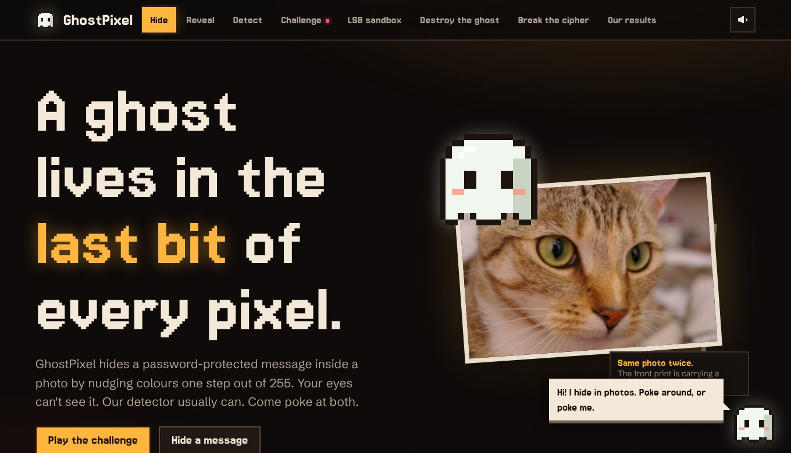
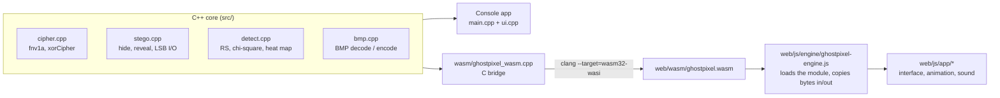
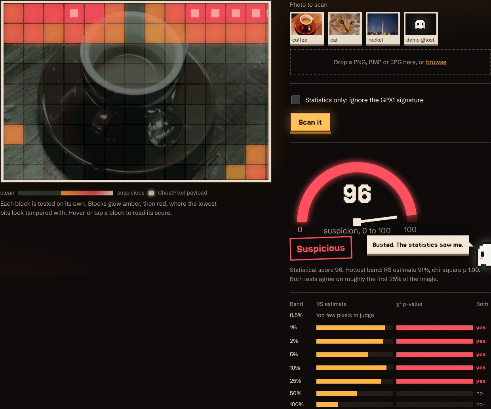

# GhostPixel

**Hide a password-protected message inside a photo, reveal it, and detect hidden data.**
A C++17 steganography project by **Team TriLogy**.

GhostPixel writes a secret into the least significant bit (LSB) of every colour byte of a 24-bit BMP image. Each colour changes by at most 1 out of 255, so the photo looks identical. A built-in detector combines RS analysis and the chi-square attack to estimate whether an image is carrying hidden data.

The same C++ code runs in two places:

- **Console app** (`src/`): a menu-driven program for hide, reveal, detect and challenge mode.
- **Website** (`web/`): an interactive version. The C++ core is compiled to **WebAssembly**, so the browser runs our C++ functions directly. JavaScript only draws the interface.



---

## Contents

- [Team](#team)
- [Quick start](#quick-start)
- [How the C++ is used](#how-the-c-is-used)
- [Project structure](#project-structure)
- [How hiding works](#how-hiding-works)
- [How detection works](#how-detection-works)
- [Tests and results](#tests-and-results)
- [Honest scope](#honest-scope)
- [Credits](#credits)

---

## Team

| Member | ID | Responsibility | Files |
|---|---|---|---|
| Alisher Xaydarov | 260247 | Image handling and the menu | `bmp.cpp`, `ui.cpp`, `main.cpp` |
| Zainab Bukhari | 260861 | Detection, encryption and embedding, testing | `detect.cpp`, `cipher.cpp`, `stego.cpp`, `tests/` |

---

## Quick start

### 1. Console app

Needs any C++17 compiler (g++, clang or Visual Studio).

```bash
# Linux / macOS
make                 # builds bin/ghostpixel
./bin/ghostpixel

# Any platform, one line
g++ -std=c++17 -O2 src/*.cpp -o ghostpixel          # Linux / macOS
g++ -std=c++17 -O2 src\*.cpp -o ghostpixel.exe      # Windows (MinGW)

# Any platform, with CMake (also works with Visual Studio)
cmake -S . -B build
cmake --build build --config Release
```

Try it on the sample photos:

```text
cd samples
../bin/ghostpixel
  1  Hide a message in a BMP image      -> coffee.bmp, type a secret and a password
  2  Reveal a hidden message            -> coffee_ghost.bmp
  3  Detect: scan an image              -> coffee.bmp (clean) and coffee_ghost.bmp
  5  Challenge mode                     -> one player hides, the other guesses
```

### 2. Unit tests

```bash
make test                                    # or:
ctest --test-dir build -C Release --output-on-failure
```

### 3. Website

The site loads WebAssembly, so it must be served over HTTP (browsers block it from `file://`).

```bash
make serve                                   # or:
python3 -m http.server 8000 --directory web
```

Then open <http://localhost:8000>.

**Live version:** once this repository is on GitHub, go to *Settings → Pages → Source: GitHub Actions*. The workflow in `.github/workflows/pages.yml` then publishes `web/` at `https://<your-username>.github.io/GhostPixel/`.

---

## How the C++ is used

All steganography, encryption, detection and BMP handling is in C++. The website calls those exact functions through WebAssembly:



| Website feature | C++ function that does the work |
|---|---|
| Hide | `hideMessage` (stego.cpp), using `xorCipher` and `fnv1a` (cipher.cpp) |
| Reveal (3 tries) | `revealMessageDetailed` (stego.cpp) |
| Detect, gauge, band table, heat map | `analyzeImage` (detect.cpp) |
| Challenge mode scores | `analyzeImage` (statistics only), `hideMessage` |
| Destroy the ghost | `revealMessageDetailed` on the edited image |
| Break the cipher | `xorCipher`, `fnv1a` |
| Opening and saving BMP files | `decodeBmp` / `encodeBmp` (bmp.cpp) |
| Our results, live check | `embedRandomBits` (stego.cpp) + `analyzeImage` |

The bridge (`wasm/ghostpixel_wasm.cpp`) only converts between C++ types and plain numbers and pointers that JavaScript can pass. It contains no GhostPixel logic. The browser handles PNG files (`png-codec.js`), because the console tool only needs BMP.

**Rebuilding the WebAssembly** after changing the C++ (the compiled `web/wasm/ghostpixel.wasm` is committed, so this is only needed after edits):

```bash
# Ubuntu / Debian: clang with the wasm32-wasi target
sudo apt install clang lld wasi-libc libc++-dev-wasm32 libc++abi-dev-wasm32 libclang-rt-dev-wasm32
make web                                     # runs wasm/build_wasm.sh
```

---

## Project structure

```text
GhostPixel/
├── src/                         C++ core and console app
│   ├── image.h                  the Image struct (B,G,R bytes, top row first)
│   ├── bmp.h / bmp.cpp          24-bit BMP decode/encode, load/save
│   ├── cipher.h / cipher.cpp    FNV-1a checksum, XOR cipher
│   ├── stego.h / stego.cpp      payload format, hide, reveal, capacity
│   ├── detect.h / detect.cpp    RS analysis, chi-square, score, heat map
│   ├── ui.h / ui.cpp            console input helpers and menu flows
│   └── main.cpp                 main menu loop
├── tests/
│   └── test_ghostpixel.cpp      37 unit tests for the core
├── wasm/
│   ├── ghostpixel_wasm.cpp      C bridge exported to JavaScript
│   ├── runtime_shim.cpp         memory allocation for the WebAssembly build
│   └── build_wasm.sh            builds web/wasm/ghostpixel.wasm
├── web/                         the website (static files, no framework)
│   ├── index.html
│   ├── css/                     base, layout, components, one file per station
│   ├── js/engine/               WebAssembly loader + PNG codec
│   ├── js/app/                  interface code, one file per concern
│   │   └── stations/            hide, reveal, detect, heatmap, challenge,
│   │                            sandbox, destroy, cipher, results
│   ├── wasm/ghostpixel.wasm     the compiled C++ core
│   └── assets/                  sample photos (PNG), favicon
├── samples/                     sample photos as 24-bit BMP for the console app
├── docs/                        screenshots
├── .github/workflows/           CI (build + tests) and GitHub Pages deploy
├── CMakeLists.txt
└── Makefile
```

The website uses plain HTML, CSS and JavaScript, with no framework and no build step. Scripts load in order with `defer`, and `main.js` starts the app once the C++ module is ready.

---

## How hiding works

Every colour byte gives up its lowest bit. Bits are written in **B, G, R order, starting at the top-left pixel**, with the **most significant bit of each payload byte first**:

| Bytes | Field | Stored as |
|---|---|---|
| 4 | `GPX1` signature | plain |
| 4 | message length (little-endian) | plain |
| 4 | FNV-1a checksum of the message | encrypted |
| N | the message | encrypted |

- **Capacity** = `width × height × 3 / 8 − 12` bytes. A 600 × 400 photo holds 89,988 bytes.
- **Encryption:** each byte is XORed with *password byte* XOR *next byte of a linear congruential generator seeded with FNV-1a(password)*. XOR is its own inverse, so the same function decrypts.
- **Checksum:** Reveal decrypts the checksum and the message, then recomputes FNV-1a. A wrong password, or an image edited after hiding, gives a mismatch, so GhostPixel reports an error instead of printing garbage.
- **Why the plain header:** it lets Reveal tell "no message here" apart from "wrong password".

Images hidden by the console app and by the website are byte-for-byte identical and interchangeable. On the website, save as BMP to open the image in the console app.

---

## How detection works

`analyzeImage` in `detect.cpp`:

1. **Signature check.** If the `GPX1` header and a valid length are present, the score is 100.
2. **RS analysis** (Fridrich, Goljan & Du, 2001) estimates what share of lowest bits was replaced, from how pixel groups react to flipping LSBs.
3. **Chi-square attack** (Westfeld & Pfitzmann, 1999). Random data in the LSBs makes the counts of each value pair (2k, 2k+1) equal. The p-value is close to 1 when they are suspiciously equal.
4. Both tests run on **growing bands from the top** (0.5% to 100% of the height), because sequential tools write from the first pixel. A band's suspicion is the **geometric mean** √(RS × p), which is high only when both tests agree.
5. **Score:** the best band × 100. 70 or more is *suspicious*, 30–69 *uncertain*, under 30 *looks clean*.
6. **Heat map:** the same combined test on square blocks (at least 32 px), each averaged with its neighbours so real data shows as a solid patch.



---

## Tests and results

**Unit tests** (`tests/test_ghostpixel.cpp`, 37 checks) cover:
- FNV-1a against the published test vector.
- Cipher round trips.
- Hide and reveal: right and wrong password, damaged payload, empty and over-capacity input, binary data.
- The guarantee that only the lowest bit ever changes.
- BMP round trips with row padding, plus truncated and invalid files.
- Detection on the sample photo, clean and with data.

**Detector measurements** on 19 real photos, statistics only (signature ignored). Random bits were written into the lowest bits from the top:

| Photos | Flagged as suspicious (score ≥ 70) |
|---|---|
| Clean | 0 of 19 (highest clean score: 21) |
| 5% hidden | 17 of 19 |
| 25% hidden | 18 of 19 |
| 100% hidden | 18 of 19 |

The misses were a logo and a black-and-white silhouette. These statistics are known to struggle on flat graphics.

---

## Honest scope

- **The cipher is for learning, not real security.** A key stream that depends only on the password can be broken. The website's *Break the cipher* station shows two attacks: key-stream reuse and brute force through the checksum.
- **Detection is a suspicion score, not proof.** Very noisy photos can score higher, and short messages from other tools can stay under the radar.
- **Our own messages are easy to find on purpose,** because of the plain `GPX1` header.
- **The message does not survive editing.** JPEG, resizing, cropping or recolouring destroy it. Only lossless copies (BMP, PNG) keep it.
- The console app reads 24-bit uncompressed BMP only. The website also reads PNG and JPG as cover images.

---

## Credits

- Sample photos from [scikit-image](https://scikit-image.org/) sample data:
  - **coffee:** Rachel Michetti, CC0, courtesy of Pikolo Espresso Bar.
  - **cat:** "Chelsea the cat", Stefan van der Walt, CC0.
  - **rocket:** DSCOVR launch on Falcon 9, SpaceX, public domain.
- RS analysis: J. Fridrich, M. Goljan, R. Du, *Reliable detection of LSB steganography in color and grayscale images* (2001).
- Chi-square attack: A. Westfeld, A. Pfitzmann, *Attacks on steganographic systems* (1999).
- Fonts: Jersey 15, Schibsted Grotesk and JetBrains Mono, via Google Fonts.
